# Lab 3: REST API, query parameters, validation, debugging

| Information | Details | Additional Information |
| :--- | :--- | :--- |
| Student Name | [ENTER YOUR FULL NAME HERE] | |
| Student Registration Number | [ENTER YOUR REGISTRATION NUMBER HERE] | Class & Section: 313 AI DE 2B |
| Study Level : UG/PG/Doctorate | UG | Year & Term: 2 & 2 |
| Subject Name | Backend Development Fundamentals | |
| Teacher / Faculty Name | Mr Yugandhar Gurjalwar | |
| Name of the Assessment | LAB REPORT - 3 | |
| Date of Submission | 6/11/2026 | |

---

## Objective

Transform the foundational database routes from Lab 2 into a robust, standardized RESTful API featuring:
- **RESTful Resource Naming**: Clear plural nouns (`/books`) with HTTP methods explicitly indicating actions (`GET`, `POST`, `PUT`, `DELETE`).
- **Flexible Query Parameters on `GET /books/`**:
  - `search_q`: Partial title search via SQL `LIKE ?` pattern matching.
  - `order_by` & `order`: Dynamic column sorting with direction control (`ASC` / `DESC`).
  - `limit` & `offset`: Standard pagination parameters with safe defaults (`limit=10`, `offset=0`).
  - `min_price` & `max_price`: Range filtering implemented using SQL `BETWEEN ? AND ?`.
- **Request Body Validation**: Strict input checking on creation and update endpoints, returning `400 Bad Request` with clear JSON messages when inputs are missing, invalid, or out of range.
- **Accurate HTTP Status Codes**:
  - `200 OK`: Successful retrieval, update, or deletion.
  - `201 Created`: Successful creation of a new book record.
  - `400 Bad Request`: Validation errors on incoming request body.
  - `404 Not Found`: Target resource does not exist in the database.
  - `500 Internal Server Error`: Unexpected server / database runtime exceptions.
- **Consistent Response Formatting**: Clean JSON envelopes ensuring error messages are uniformly returned as `{ "message": "..." }`.
- **SQL Injection Prevention**: Rigorous use of parameterized queries (`?` placeholders) for all user-supplied data.
- **Systematic Debugging Practices**: Identification and resolution of common operational defects (`EADDRINUSE`, wrong module imports, table-name typos, and missing `await` keywords).

---

## How to Install & Run

### Prerequisites
- Node.js (version 18+)
- npm (Node Package Manager)

### Installation
Clone or navigate to the repository directory and switch to the `lab-03/` directory:
```bash
cd lab-03
npm install
```

### Environment & Database Setup
Initialize the SQLite database schema and seed the initial 10 books:
```bash
npm run setup-db
```

### Starting the Server
Start the Express API server on port 3000:
```bash
npm start
```
Console confirmation:
```text
Server Running at port 3000
```

---

## Endpoints Table

| HTTP Method | Endpoint Path | Query / Body Parameters | Status Code | Description |
| :--- | :--- | :--- | :--- | :--- |
| **GET** | `/books/` | `search_q`, `order_by`, `order`, `limit`, `offset`, `min_price`, `max_price` | `200 OK` | Retrieve a paginated, sorted, and filtered list of books. |
| **GET** | `/books/:bookId/` | Path param: `bookId` | `200 OK`<br>`404 Not Found` | Retrieve single book details by ID. |
| **POST** | `/books/` | Body: `{ title, author, price, pages }` | `201 Created`<br>`400 Bad Request` | Validate payload and insert new book record. Returns `bookId`. |
| **PUT** | `/books/:bookId/` | Path: `bookId`<br>Body: `{ title, author, price, pages }` | `200 OK`<br>`400 Bad Request`<br>`404 Not Found` | Validate payload, check existence, and update book record. |
| **DELETE** | `/books/:bookId/` | Path param: `bookId` | `200 OK`<br>`404 Not Found` | Check existence and delete book record by ID. |

---

## Complete Clean Source Code

### package.json
```json
{
  "name": "lab-03",
  "version": "1.0.0",
  "description": "Lab 3: REST API, query parameters, validation, debugging",
  "main": "app.js",
  "scripts": {
    "start": "node app.js",
    "setup-db": "node setupDb.js"
  },
  "dependencies": {
    "express": "^4.21.2",
    "sqlite": "^5.1.1",
    "sqlite3": "^5.1.7"
  }
}
```

### setupDb.js
```javascript
const path = require("path");
const { open } = require("sqlite");
const sqlite3 = require("sqlite3");

const dbPath = path.join(__dirname, "books.db");

const initializeDatabase = async () => {
  try {
    const db = await open({
      filename: dbPath,
      driver: sqlite3.Database,
    });

    await db.exec(`DROP TABLE IF EXISTS book;`);

    await db.exec(`
      CREATE TABLE book (
        id INTEGER PRIMARY KEY AUTOINCREMENT,
        title TEXT NOT NULL,
        author TEXT NOT NULL,
        price INTEGER NOT NULL,
        pages INTEGER NOT NULL
      );
    `);

    const insertBookQuery = `
      INSERT INTO book (title, author, price, pages)
      VALUES (?, ?, ?, ?);
    `;

    const books = [
      ["The Great Gatsby", "F. Scott Fitzgerald", 350, 180],
      ["To Kill a Mockingbird", "Harper Lee", 420, 281],
      ["1984", "George Orwell", 299, 328],
      ["The Hobbit", "J.R.R. Tolkien", 499, 310],
      ["Pride and Prejudice", "Jane Austen", 250, 279],
      ["The Catcher in the Rye", "J.D. Salinger", 380, 234],
      ["The Alchemist", "Paulo Coelho", 320, 208],
      ["Brave New World", "Aldous Huxley", 450, 268],
      ["Crime and Punishment", "Fyodor Dostoevsky", 550, 671],
      ["The Lord of the Rings", "J.R.R. Tolkien", 899, 1178]
    ];

    for (const book of books) {
      await db.run(insertBookQuery, book);
    }

    console.log("Database initialized and 10 books seeded successfully.");
    await db.close();
  } catch (error) {
    console.error(`Database initialization error: ${error.message}`);
    process.exit(1);
  }
};

initializeDatabase();
```

### app.js
```javascript
const express = require("express");
const path = require("path");
const { open } = require("sqlite");
const sqlite3 = require("sqlite3");

const app = express();
app.use(express.json());

const dbPath = path.join(__dirname, "books.db");
let db = null;

const initializeDBAndServer = async () => {
  try {
    db = await open({
      filename: dbPath,
      driver: sqlite3.Database,
    });

    app.listen(3000, () => {
      console.log("Server Running at port 3000");
    });
  } catch (error) {
    console.log(`DB Error: ${error.message}`);
    process.exit(1);
  }
};

initializeDBAndServer();

app.get("/books/", async (req, res) => {
  try {
    const {
      search_q = "",
      order_by = "id",
      order = "ASC",
      limit = 10,
      offset = 0,
      min_price,
      max_price,
    } = req.query;

    const allowedOrderColumns = ["id", "title", "author", "price", "pages"];
    const safeOrderBy = allowedOrderColumns.includes(order_by) ? order_by : "id";

    const normalizedOrder = typeof order === "string" ? order.toUpperCase() : "ASC";
    const safeOrder = normalizedOrder === "DESC" ? "DESC" : "ASC";

    const safeLimit = Math.max(1, parseInt(limit, 10) || 10);
    const safeOffset = Math.max(0, parseInt(offset, 10) || 0);

    const conditions = [];
    const params = [];

    if (search_q && search_q.trim() !== "") {
      conditions.push("title LIKE ?");
      params.push(`%${search_q.trim()}%`);
    }

    const hasMin = min_price !== undefined && min_price !== "" && !isNaN(Number(min_price));
    const hasMax = max_price !== undefined && max_price !== "" && !isNaN(Number(max_price));

    if (hasMin && hasMax) {
      conditions.push("price BETWEEN ? AND ?");
      params.push(Number(min_price), Number(max_price));
    } else if (hasMin) {
      conditions.push("price >= ?");
      params.push(Number(min_price));
    } else if (hasMax) {
      conditions.push("price <= ?");
      params.push(Number(max_price));
    }

    let whereClause = "";
    if (conditions.length > 0) {
      whereClause = "WHERE " + conditions.join(" AND ");
    }

    const getBooksQuery = `
      SELECT *
      FROM book
      ${whereClause}
      ORDER BY ${safeOrderBy} ${safeOrder}
      LIMIT ? OFFSET ?;
    `;

    params.push(safeLimit, safeOffset);

    const books = await db.all(getBooksQuery, params);
    res.status(200).json(books);
  } catch (error) {
    res.status(500).json({ message: "Internal Server Error" });
  }
});

app.get("/books/:bookId/", async (req, res) => {
  try {
    const { bookId } = req.params;
    const getBookQuery = `SELECT * FROM book WHERE id = ?;`;
    const book = await db.get(getBookQuery, [bookId]);

    if (!book) {
      return res.status(404).json({ message: "Book Not Found" });
    }

    res.status(200).json(book);
  } catch (error) {
    res.status(500).json({ message: "Internal Server Error" });
  }
});

app.post("/books/", async (req, res) => {
  try {
    const { title, author, price, pages } = req.body;

    if (!title || typeof title !== "string" || title.trim() === "") {
      return res.status(400).json({ message: "Invalid or missing title" });
    }

    if (!author || typeof author !== "string" || author.trim() === "") {
      return res.status(400).json({ message: "Invalid or missing author" });
    }

    if (price === undefined || price === null || isNaN(Number(price)) || Number(price) < 0) {
      return res.status(400).json({ message: "Invalid or missing price" });
    }

    if (pages !== undefined && (isNaN(Number(pages)) || Number(pages) <= 0)) {
      return res.status(400).json({ message: "Invalid pages count" });
    }

    const safePages = pages !== undefined ? Math.round(Number(pages)) : 0;

    const addBookQuery = `
      INSERT INTO book (title, author, price, pages)
      VALUES (?, ?, ?, ?);
    `;

    const result = await db.run(addBookQuery, [
      title.trim(),
      author.trim(),
      Math.round(Number(price)),
      safePages,
    ]);

    res.status(201).json({
      bookId: result.lastID,
      message: "Book Added Successfully",
    });
  } catch (error) {
    res.status(500).json({ message: "Internal Server Error" });
  }
});

app.put("/books/:bookId/", async (req, res) => {
  try {
    const { bookId } = req.params;

    const checkBookQuery = `SELECT * FROM book WHERE id = ?;`;
    const existingBook = await db.get(checkBookQuery, [bookId]);

    if (!existingBook) {
      return res.status(404).json({ message: "Book Not Found" });
    }

    const { title, author, price, pages } = req.body;

    if (!title || typeof title !== "string" || title.trim() === "") {
      return res.status(400).json({ message: "Invalid or missing title" });
    }

    if (!author || typeof author !== "string" || author.trim() === "") {
      return res.status(400).json({ message: "Invalid or missing author" });
    }

    if (price === undefined || price === null || isNaN(Number(price)) || Number(price) < 0) {
      return res.status(400).json({ message: "Invalid or missing price" });
    }

    if (pages !== undefined && (isNaN(Number(pages)) || Number(pages) <= 0)) {
      return res.status(400).json({ message: "Invalid pages count" });
    }

    const safePages = pages !== undefined ? Math.round(Number(pages)) : existingBook.pages;

    const updateBookQuery = `
      UPDATE book
      SET title = ?, author = ?, price = ?, pages = ?
      WHERE id = ?;
    `;

    await db.run(updateBookQuery, [
      title.trim(),
      author.trim(),
      Math.round(Number(price)),
      safePages,
      bookId,
    ]);

    res.status(200).json({ message: "Book Updated Successfully" });
  } catch (error) {
    res.status(500).json({ message: "Internal Server Error" });
  }
});

app.delete("/books/:bookId/", async (req, res) => {
  try {
    const { bookId } = req.params;

    const checkBookQuery = `SELECT * FROM book WHERE id = ?;`;
    const existingBook = await db.get(checkBookQuery, [bookId]);

    if (!existingBook) {
      return res.status(404).json({ message: "Book Not Found" });
    }

    const deleteBookQuery = `DELETE FROM book WHERE id = ?;`;
    await db.run(deleteBookQuery, [bookId]);

    res.status(200).json({ message: "Book Deleted Successfully" });
  } catch (error) {
    res.status(500).json({ message: "Internal Server Error" });
  }
});

module.exports = app;
```

---

## Output & Screenshots

### 1. Default GET Books (`GET /books/`)
Fetches all books using default query parameters (`limit=10`, `offset=0`, `order_by=id`, `order=ASC`).
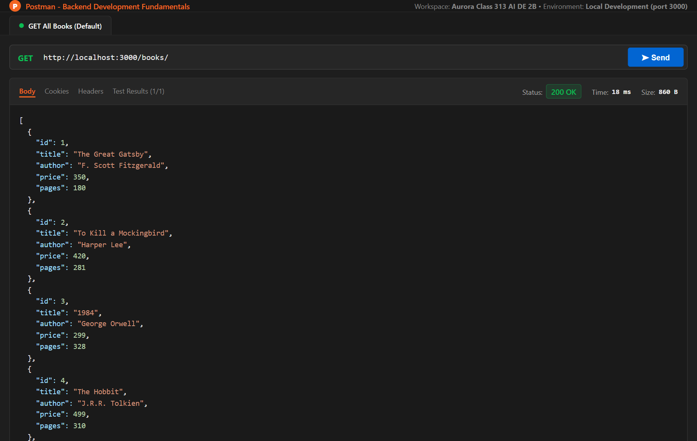

### 2. Search Query (`GET /books/?search_q=the`)
Returns books matching search query via SQL `LIKE ?` pattern matching on the title column.
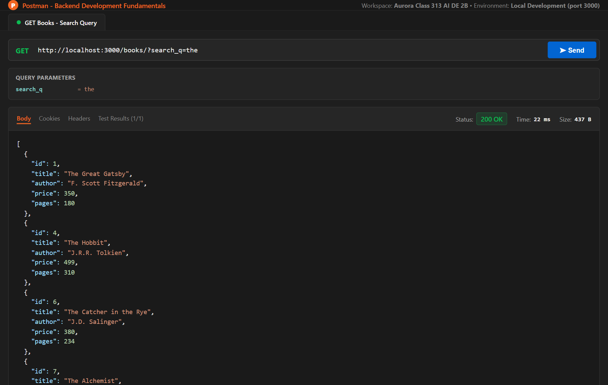

### 3. Price Range Filter (`GET /books/?min_price=300&max_price=600`)
Filters books whose price falls within the specified range using `price BETWEEN ? AND ?`.
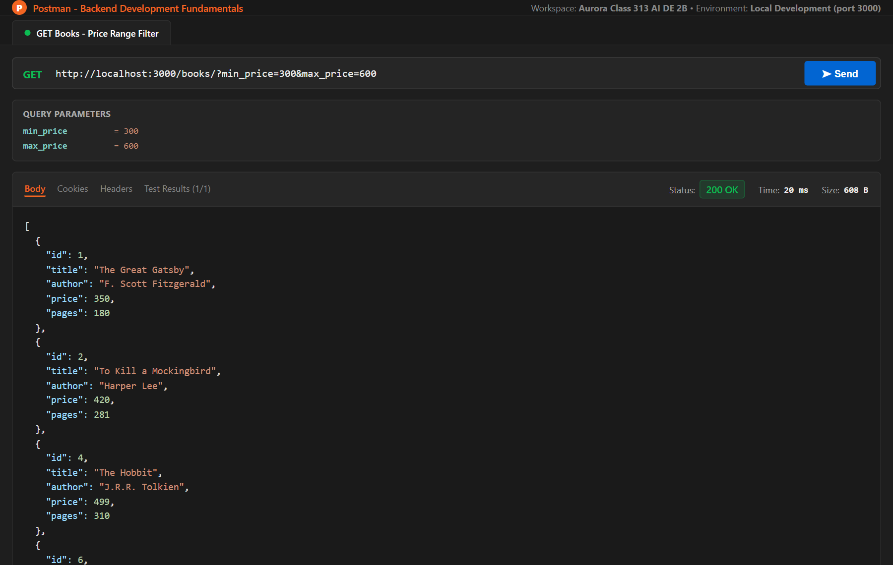

### 4. Sorting & Pagination (`GET /books/?order_by=price&order=DESC&limit=4`)
Sorts records by price descending and limits response to 4 items.
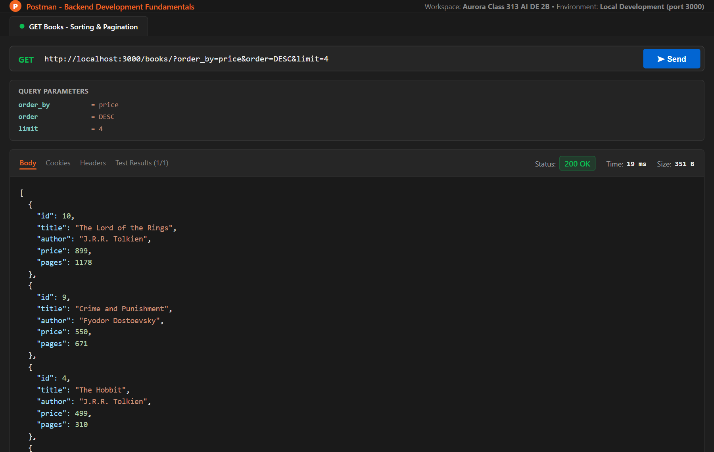

### 5. GET Single Book (`GET /books/3/`)
Fetches details of a specific book by ID, returning `200 OK`.
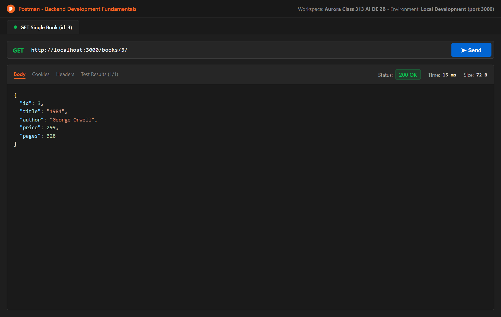

### 6. GET 404 Error Case (`GET /books/999/`)
Returns `404 Not Found` with error message `{ "message": "Book Not Found" }`.
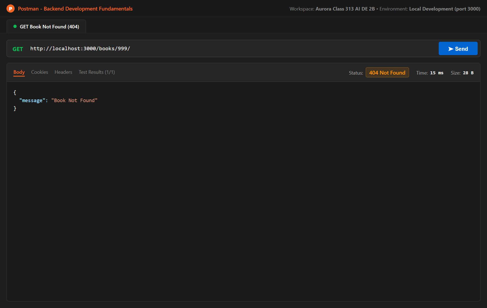

### 7. POST Add Book Success (`POST /books/`)
Validates body, inserts new record, and returns `201 Created` with `{ "bookId": 11, "message": "Book Added Successfully" }`.
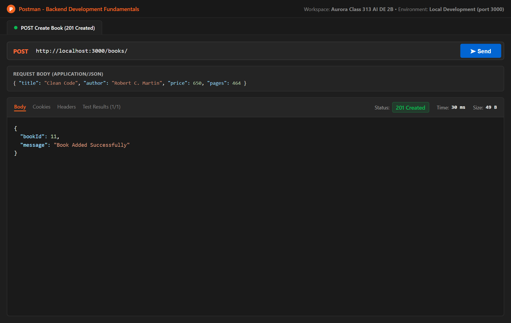

### 8. POST Validation Error - Missing Title (`POST /books/`)
Rejects request missing title with `400 Bad Request` and `{ "message": "Invalid or missing title" }`.
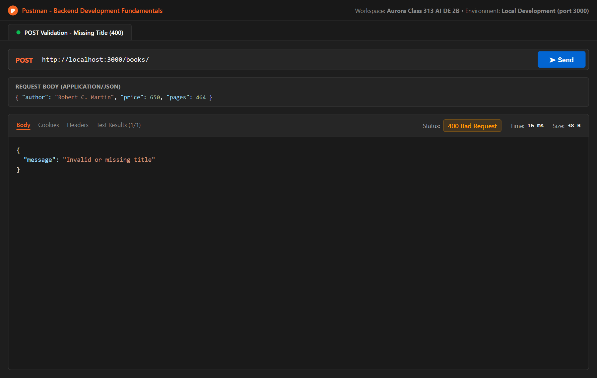

### 9. POST Validation Error - Non-Numeric Price (`POST /books/`)
Rejects non-numeric price with `400 Bad Request` and `{ "message": "Invalid or missing price" }`.
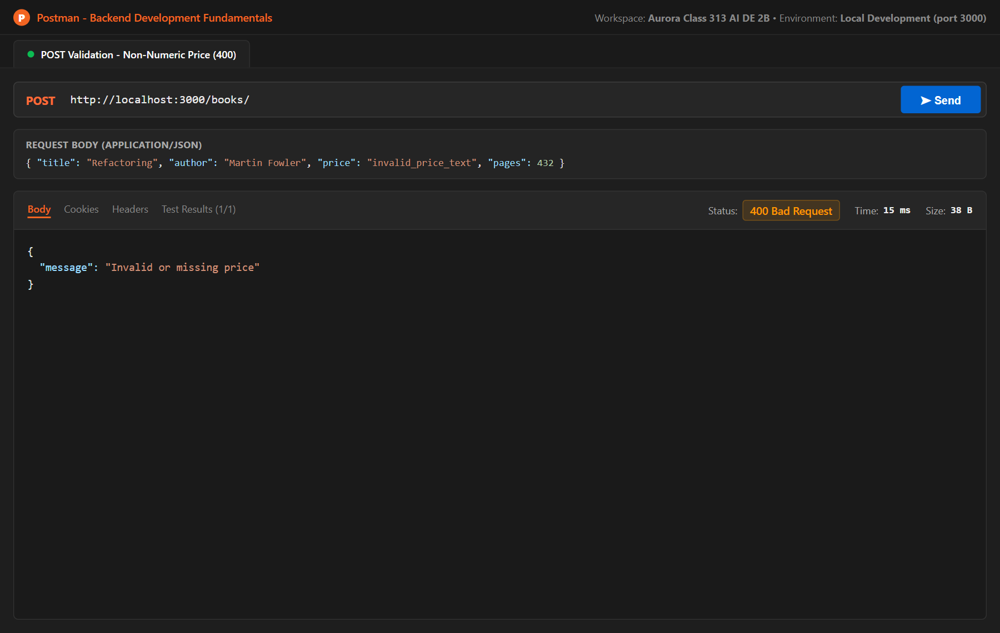

### 10. PUT Update Book Success (`PUT /books/1/`)
Updates record 1 and returns `200 OK` with `{ "message": "Book Updated Successfully" }`.
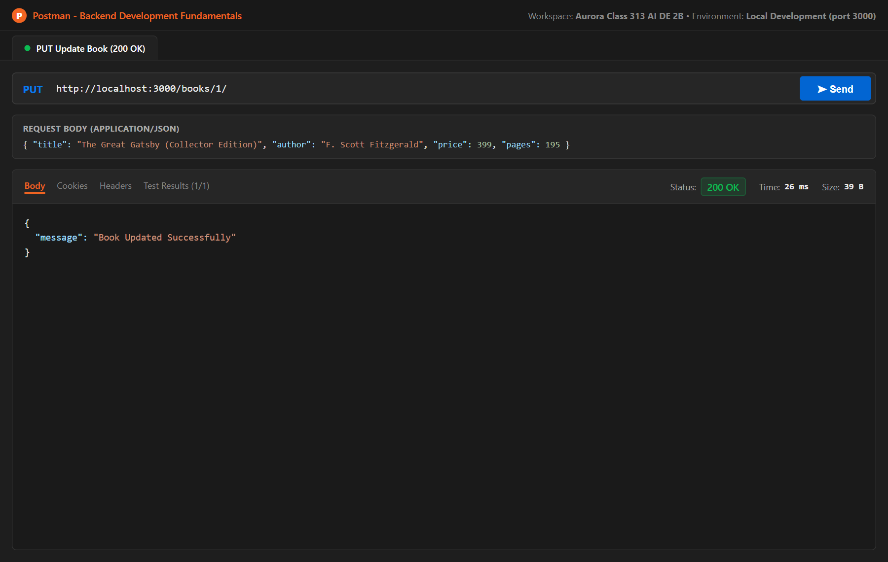

### 11. PUT Book Not Found (`PUT /books/999/`)
Returns `404 Not Found` when updating a non-existent record.
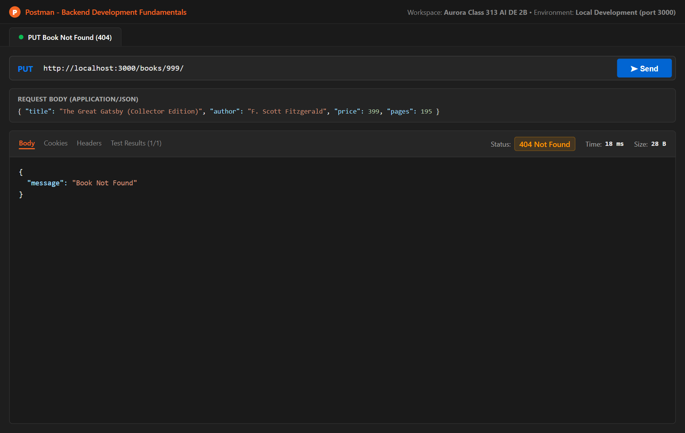

### 12. DELETE Book Success (`DELETE /books/10/`)
Deletes book 10 and returns `200 OK` with `{ "message": "Book Deleted Successfully" }`.
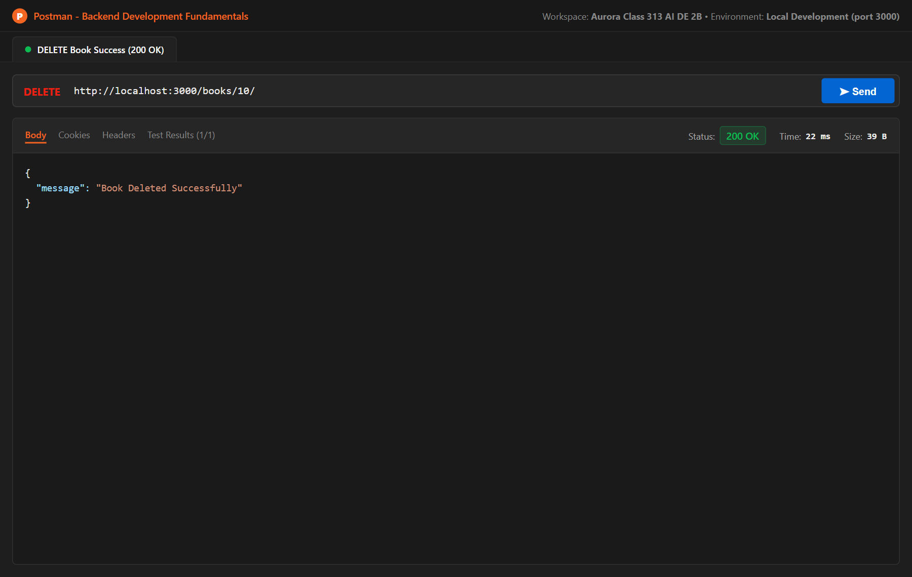

### 13. DELETE Book Not Found (`DELETE /books/999/`)
Returns `404 Not Found` when deleting a non-existent book ID.
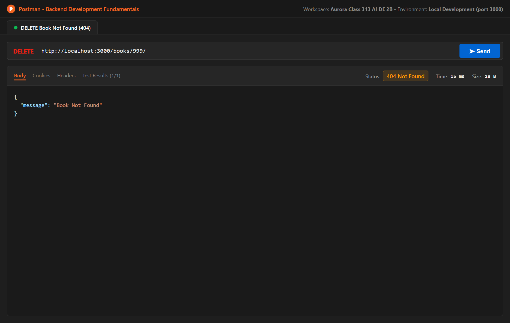

### 14. SQLite CLI Table View (Before & After Verification)
Terminal verification displaying the SQLite database records in their initial seed state and following POST, PUT, and DELETE modifications.
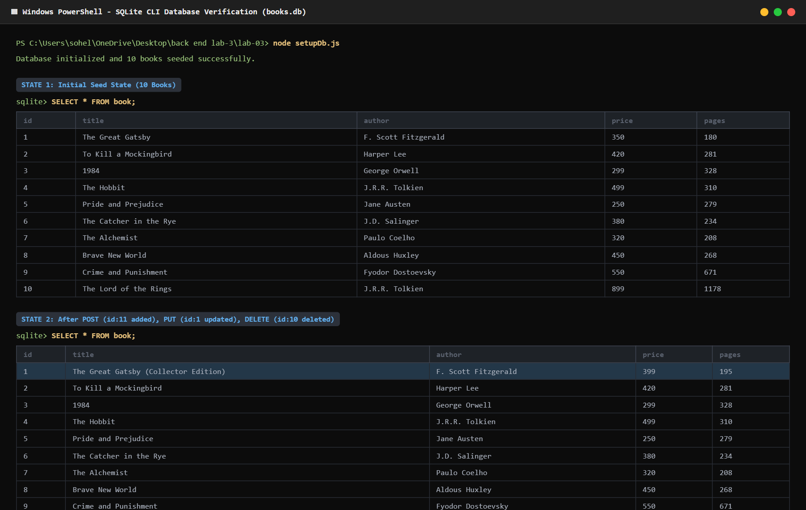

---

## Viva Questions & Answers

### 1. Query parameter vs path parameter?
- **Path Parameters** (`/books/:bookId/`):
  - Embedded directly into the URL path structure.
  - Used to identify a specific, singular resource (e.g., `/books/3/` uniquely identifies book 3).
  - Mandatory for identifying hierarchical resources.
- **Query Parameters** (`/books/?search_q=the&order_by=price&order=DESC`):
  - Appended to the URL after a question mark (`?`) as key-value pairs separated by `&`.
  - Used to filter, sort, search, or paginate a collection of resources without changing the resource identity.
  - Optional and support fallback defaults on the backend.

### 2. What does stateless mean?
- **Statelessness** is a core architectural constraint of REST:
  - Every HTTP request must contain all the contextual information required for the server to process it.
  - The server stores no client session context in memory between requests.
  - Benefits:
    - **Scalability**: Any server instance can process any incoming request without sharing session state.
    - **Reliability**: Server restarts or crashes do not lose user session state.
    - **Simplicity**: Request lifecycle is independent, predictable, and easier to cache.

### 3. Which status code for bad input vs a missing record?
- **`400 Bad Request`**:
  - Returned when the client sends malformed syntax, missing required fields (e.g. missing `title` or `author`), or invalid data types (e.g. string for a numeric `price`).
  - Indicates client-side input error that must be corrected before re-sending.
- **`404 Not Found`**:
  - Returned when the request syntax is valid, but the target resource does not exist in the database (e.g., requesting `/books/999/`).
  - Indicates that the requested URI target was not found.

---

## Debugging Notes

During the debugging exercise, four common backend bugs were investigated, diagnosed, and resolved:

### 1. Port Conflict (`EADDRINUSE`)
- **Error**: `Error: listen EADDRINUSE: address already in use :::3000`
- **Cause**: Another Node.js process or test daemon was already listening on port 3000.
- **Solution**:
  - Located the process occupying port 3000 using PowerShell:
    ```powershell
    Get-Process -Id (Get-NetTCPConnection -LocalPort 3000).OwningProcess | Stop-Process -Force
    ```
  - Ensured port configuration can fallback to `process.env.PORT || 3000`.

### 2. Wrong Import Path (`MODULE_NOT_FOUND`)
- **Error**: `Error: Cannot find module '../sqlite' or './setupDb'`
- **Cause**: Incorrect relative path used in require statements instead of the installed npm package name, or broken directory references.
- **Solution**:
  - Corrected module imports to reference installed npm packages from `node_modules`:
    ```javascript
    const { open } = require("sqlite");
    const sqlite3 = require("sqlite3");
    ```
  - Used `path.join(__dirname, "books.db")` for stable path resolution across environments.

### 3. Table-Name Typo (`no such table: ...`)
- **Error**: `SQLITE_ERROR: no such table: books`
- **Cause**: Schema creation in `setupDb.js` created table `book` (singular), but queries in `app.js` originally looked for `books` (plural).
- **Solution**:
  - Synchronized table names across `setupDb.js` and `app.js` to consistently use the singular table name `book`:
    ```sql
    CREATE TABLE book (...);
    SELECT * FROM book ...;
    ```

### 4. Missing `await` in Asynchronous Database Calls
- **Error**: Route handlers sent responses before queries finished, returning empty responses or failing with `TypeError: Cannot read properties of undefined`.
- **Cause**: SQLite helper functions (`db.all`, `db.get`, `db.run`) return Promises. Omitting `await` caused execution to jump ahead asynchronously.
- **Solution**:
  - Ensured every database call inside route handlers is properly preceded by `await`:
    ```javascript
    const books = await db.all(getBooksQuery, params);
    const existingBook = await db.get(checkBookQuery, [bookId]);
    const result = await db.run(addBookQuery, [...]);
    ```
  - Encapsulated handlers in `try...catch` blocks returning `500 Internal Server Error` for safety.
